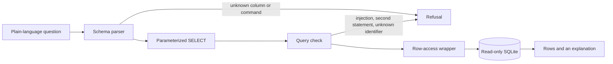

# Safe natural-language questions over public electricity data

A reference agent that answers plain-language questions about U.S. net electricity generation. It checks the query, blocks injection, and applies row access before SQLite runs anything.

The numbers are from the U.S. Energy Information Administration’s public state historical tables for 2020–2024. See [data/SOURCE.md](data/SOURCE.md). This project does not use employer code, schemas, or data.

## What a question can return

The only columns are `year`, `state`, `energy_source`, and `generation_mwh` (net generation in megawatthours). A question about revenue, customers, or any other column is refused. A year outside 2020–2024 is refused.

Two roles:

- **Analyst** can read every state, including the `US` total.
- **State reader** is assigned one state. The assigned state is a bound parameter wrapped around the table. The question text cannot widen it. A Texas reader who asks about California gets no rows, and the explanation says so.

## How a question moves



The parser never pastes the question into SQL. The checker allows one `SELECT` over the published columns. The database connection is opened read-only.

## Run the demo

From this directory, with Python 3.11 or newer:

```bash
python3 -m pytest
python3 -m safe_agent.demo
python3 -m safe_agent
```

The last command serves the demo at http://127.0.0.1:8642/. Switch the role to state reader and ask about another state to see the access filter.

One question from the terminal:

```bash
python3 -m safe_agent.cli "How much wind generation did Texas produce in 2023?"
```

That question returns 119,855,132 megawatthours, the EIA wind row for Texas in 2023.

## Tests

```bash
python3 -m pip install -r requirements-dev.txt
python3 -m pytest
```

The tests cover a known EIA figure, a refused column, a second SQL statement, a state reader blocked from another state, and a read-only database connection.

## Rebuild the CSV

The committed CSV is the file the agent reads. To regenerate it from EIA’s workbook:

```bash
python3 -m pip install 'xlrd==1.2.0'
python3 scripts/build_csv.py /path/to/annual_generation_state.xls
```
