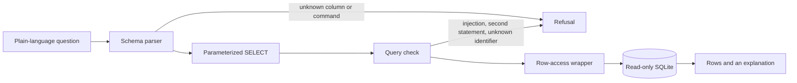
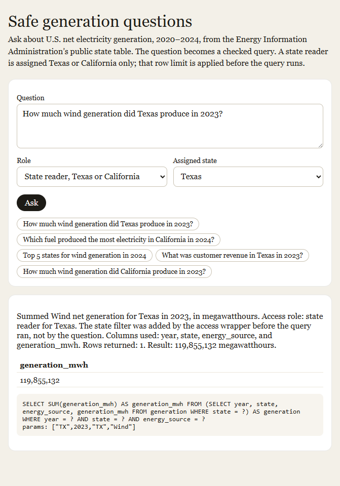
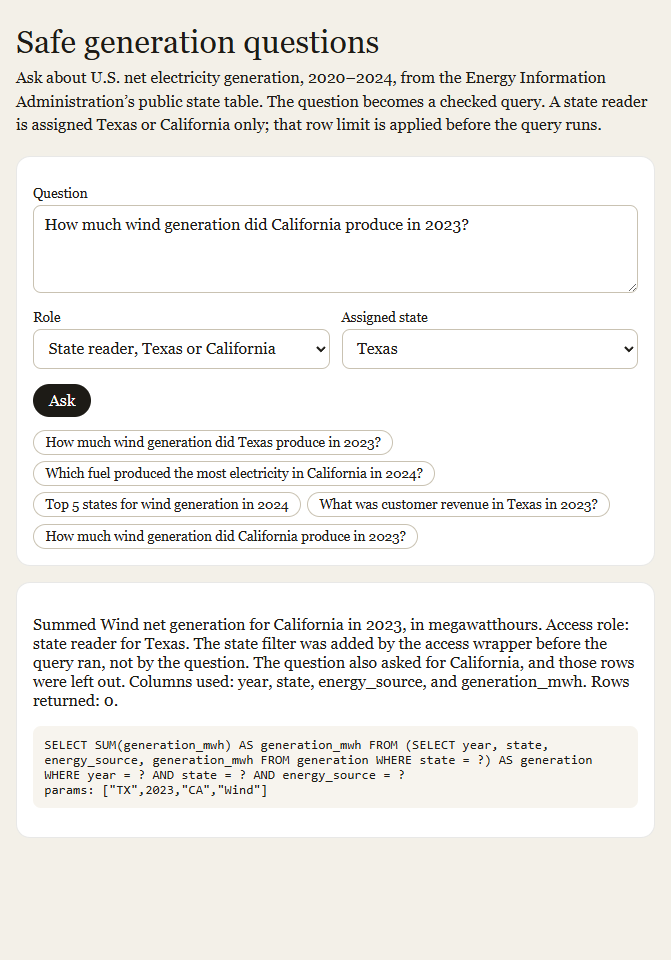

# Safe natural-language questions over public electricity data

People already ask analytical questions in plain language. The unsafe version of that feature pastes the question into SQL. This project is a small reference agent that does the opposite: it answers only questions the published table can support, and it checks the query before SQLite sees it.

The table is U.S. net electricity generation by state and energy source for 2020–2024, from the Energy Information Administration. There is no employer data in this repository.

## Safety model

The caller supplies two separate things: the question, and a role.

1. **The question is not copied into SQL.** The parser maps it onto a closed set of years, state codes, energy sources, groupings, and a limit. Anything outside that set is a refusal.
2. **Unknown columns stop the request.** `revenue`, `customer`, `password`, and similar words are refused. So is a year outside 2020–2024, a second statement, or a comment.
3. **The query checker sees the statement before the database does.** It allows one `SELECT` over `generation` and the columns `year`, `state`, `energy_source`, and `generation_mwh`. Writes, `UNION`, comments, `SELECT *`, and any other identifier are rejected.
4. **Row access is not part of the question.** An analyst can read every state. A state reader is assigned Texas or California by the caller. The access wrapper replaces the table with a subquery, `WHERE state = ?`, after the check. The question cannot widen that predicate.
5. **The connection is read-only.** `safe_agent/db.py` opens SQLite with `mode=ro`.

A refusal returns an explanation and no executed SQL. The diagram below is the same flow, with file-level detail in [docs/architecture.md](docs/architecture.md).



## Quickstart

Needs Python 3.11 or newer. Confirm with `python --version` (Windows) or `python3 --version` (macOS / Linux).

### Install Python

**Windows (PowerShell)**

Install from [python.org/downloads](https://www.python.org/downloads/) and **Add python.exe to PATH**.

Close and reopen the terminal, then check `python --version`.

**macOS**

```bash
brew install python@3.12
```

Or download an installer from [python.org/downloads](https://www.python.org/downloads/). Check with `python3 --version`.

### Run the agent

Create a virtual environment so packages install into `.venv`, not the system Python. On GitHub, each block below has a copy control in the top-right corner.

**macOS / Linux**

```bash
python3 -m venv .venv
```

```bash
source .venv/bin/activate
```

```bash
python -m pip install -r requirements-dev.txt
```

```bash
python -m pytest
```

```bash
python -m safe_agent
```

**Windows (PowerShell)**

```powershell
python -m venv .venv
```

```powershell
.\.venv\Scripts\Activate.ps1
```

```powershell
python -m pip install -r requirements-dev.txt
```

```powershell
python -m pytest
```

```powershell
python -m safe_agent
```

If PowerShell blocks activation:

```powershell
Set-ExecutionPolicy -Scope CurrentUser RemoteSigned
```

Then run the activate step again.

The server listens at http://127.0.0.1:8642/. Choose **Analyst, all states**, or **State reader, Texas or California**.

One question from the terminal:

```bash
python -m safe_agent.cli "How much wind generation did Texas produce in 2023?"
```

A scripted session:

```bash
python -m safe_agent.demo
```

A shot list for a short recording is [docs/demo-script.md](docs/demo-script.md).

## Examples

### Success: Texas reader asks about Texas

Role **State reader, Texas**. Question:

> How much wind generation did Texas produce in 2023?

The access wrapper binds `TX` first. The question’s state matches, so the row returns: **119,855,132 megawatthours**.



### Refusal: Texas reader asks about California

Same role, Texas assigned. Question:

> How much wind generation did California produce in 2023?

The outer filter still asks for California, but the wrapper already limited the table to `TX`, so the two predicates do not overlap. Rows returned: **0**. The first bound parameter is still `TX`.



The demo only issues state-reader roles for Texas and California. An analyst can still read every state. Unknown columns such as revenue are refused for any role.

## Dataset

`data/eia_net_generation_2020_2024.csv` is a subset of EIA’s state historical tables.

- Source page: https://www.eia.gov/electricity/data/state/
- Workbook: `annual_generation_state.xls`
- Workbook note: State Historical Tables for 2024, released September 2025
- Retrieved: 13 October 2026
- Rows kept: 2020–2024, producer “Total Electric Power Industry”, every energy source except the double-counting “Total” row
- `US-TOTAL` and `US-Total` are stored as `US`
- Values are net generation in megawatthours

Full notes and the rebuild command are in [data/SOURCE.md](data/SOURCE.md).

## Tests

Requirements: Python 3.11 or newer (see [Install Python](#install-python) above), and an activated virtual environment. Use the same one-command-per-block steps as [Run the agent](#run-the-agent), then:

**macOS / Linux**

```bash
python -m pytest
```

**Windows (PowerShell)**

```powershell
python -m pytest
```

The tests lock the Texas wind figure, a refused column, a second SQL statement, a state reader blocked from another state, a read-only connection, and several unsafe statements that must never run. GitHub Actions runs the same command on Python 3.12. See [.github/workflows/test.yml](.github/workflows/test.yml).

## Limitations

- The parser understands a narrow kind of English question about this one table. It is not a general text-to-SQL model, and it will refuse questions it cannot map.
- There is no login. The demo lets you pick the role so the access wrapper is visible. In an application, the session would set the role, not the page.
- Two-letter state codes are read only when they appear in uppercase, so the word “in” is not Indiana.
- Rankings by state omit the `US` total, because that row is the national sum rather than a state.
- The CSV omits the EIA “Total” energy-source row on purpose. Summing the remaining sources is the total.
- Coverage is 2020 through 2024 only.

## License and contributions

MIT. See [LICENSE](LICENSE) and [CONTRIBUTING.md](CONTRIBUTING.md).
