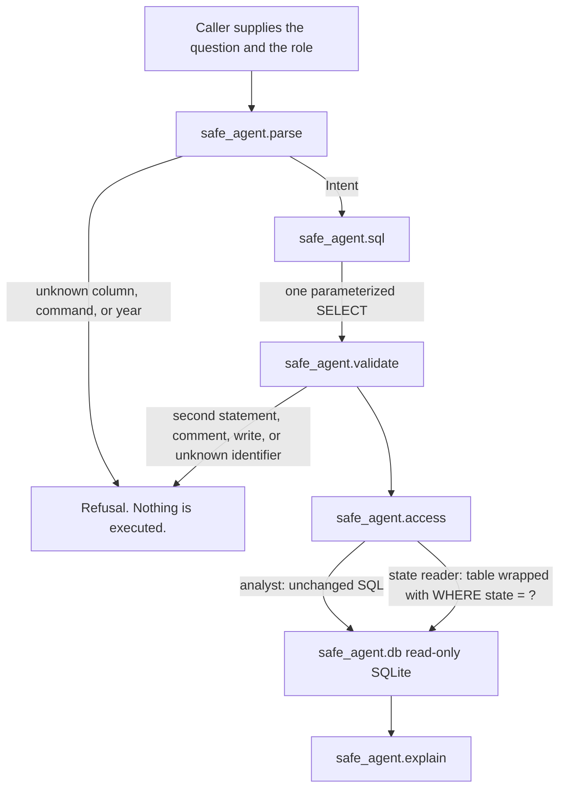

# Architecture

A question never becomes SQL by string pasting. Each stage either returns a closed value the next stage already understands, or it stops.



## Stages

| Stage | Module | What it may do |
|---|---|---|
| Orchestration | `safe_agent/engine.py` | Call the stages in order. On refusal, return an explanation and no SQL result. |
| Parse | `safe_agent/parse.py` | Map the question onto years, state codes, energy sources, grouping, and a limit. The only vocabulary is `safe_agent/schema.py`. |
| SQL | `safe_agent/sql.py` | Fill a fixed `SELECT … SUM(generation_mwh) …` shape. Values go in `?` parameters. |
| Check | `safe_agent/validate.py` | Allow one `SELECT` whose identifiers are the published table and columns, plus `SUM` and ordinary SQL words. |
| Access | `safe_agent/access.py` | For a state reader, replace `FROM generation` with a subquery filtered by a bound state code. The question cannot write this clause. |
| Database | `safe_agent/db.py` | Build SQLite from the committed CSV if needed, then open it with `mode=ro`. |
| Explanation | `safe_agent/explain.py` | State the aggregation, the columns, the role, and the row count. |

`safe_agent/web.py` and `safe_agent/cli.py` are callers. They pass a `Principal`. They do not accept a SQL string.

## Access wrapper

For a state reader assigned to Texas, the checked statement:

```sql
SELECT SUM(generation_mwh) AS generation_mwh
FROM generation
WHERE year = ? AND state = ? AND energy_source = ?
```

is executed as:

```sql
SELECT SUM(generation_mwh) AS generation_mwh
FROM (
  SELECT year, state, energy_source, generation_mwh
  FROM generation
  WHERE state = ?
) AS generation
WHERE year = ? AND state = ? AND energy_source = ?
```

The first parameter is the assigned state. A question about California still carries `CA` in the outer predicate, so the intersection is empty. That is the intended result.

## What is deliberately absent

There is no model call, no tool that runs arbitrary SQL, and no write statement. Adding any of those would need a new check and a test that shows the refusal.
